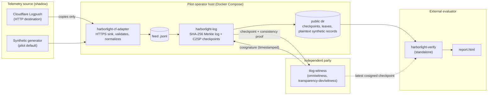

# SGAIL Stage 2: Minimum Commercial Pilot, plan

2026-11-24 · Witness v3.4.0 (`a78b609`) · status: **implementation authorized 2026-11-25** (see §0 and §9).

Labels used below:
- **[VERIFIED]:** checked in our code, our tests, or a cited public document.
- **[INFERENCE]:** reasoning from verified facts.
- **[TO VERIFY]:** must be confirmed before anything depends on it.

## 0. Authorization gate

The mission says: *"Do not begin implementation until the Phase 1 conformance assessment has been completed and reviewed by SGAIL leadership."*

- **Phase 1 is complete:** branch `poc/phase1-gap-matrix`, commit `9081ac2`.
- **Leadership review:** on 2026-11-25 SGAIL leadership (the founder) answered the §9 decisions with "Proceed with one through four as you see fit". This is recorded as authorization to implement, given by leadership. It is **not** a record of a separate written review of Phase 1; if one is wanted for the file, it is still to be written.
- **Already open, and carried over from the Proof-of-Control (PoC) plan:**
  - PR #77, consistency proofs;
  - PR #78, the clean-room evidence verifier.

  Both are reviewed code that the pilot reuses; neither is new Stage 2 work.

## Implementation status (2026-11-25)

Branch `stage2/pilot`. Everything below was run on the development workstation unless it says otherwise.

### Mission requirements → where they are met

| Requirement | State | Where |
|---|---|---|
| Consistency proofs | **Done** | `pkg/tlog` (SHA-256; cross-checked against `x/mod/sumdb/tlog` for every size up to 80); PR #77 for the BLAKE3 Witness log (merged) |
| Pinned keys | **Done** | The verifier requires `--log-key` and witness keys; there is no trust-on-first-use, and `log.json` is ignored |
| Independently retained checkpoints | **Mechanism done; independence pending approval** | A tlog-witness client; interop with unmodified omniwitness. The demo witness runs on the operator's host and every report says so |
| Verified crash recovery | **Done for the pilot log** | A torn write is quarantined and recorded (A17); the log refuses to start over altered or lost evidence (A18, unit tests); a replayed record is reported as a replay (A06) |
| Standalone verifier, no private keys | **Done** | `harborlight-verify`: public directory plus public keys |
| Lightweight independent witness service | **INTEGRATE: done** | `transparency-dev/witness` omniwitness, pinned and unmodified |
| Cloudflare-compatible adapter, public interfaces, synthetic data | **Done** | `harborlight-cf-adapter`, built from the public Logpush docs only; `synth` uses documented field names with invented values |
| Docker Compose | **Written, not run** | `pilot/compose.yaml`, `pilot/Dockerfile`. No Docker on the development workstation. `pilot/demo.sh` runs the same topology and is tested |
| Shadow mode | **Done, by construction** | The adapter is a sink with no Cloudflare credential and no outbound request |
| Completeness limits and trust boundaries disclosed | **Done** | In every report (disclosures, completeness section, witness independence); `THREAT-MODEL.md` |
| Adversarial regression tests | **Done** | 29 cases (`harborlight-adversarial`, also `go test`; 2 pinned known limits), plus adapter, interop and Rekor tests |
| Lucid kept inside the research harness | **Done** | No pilot component references it |
| Exportable verification report | **Done** | `--report` (single-file HTML, no scripts) and `--json` |
| Costs, resources, maintenance | **Done (measured)** | `BENCHMARKS-AND-COST.md`. Prices are deliberately left as variables |
| PoC compatibility | **Partial** | SHA-256 aligned. `pkg/pocverify` (PR #78) is not yet wired into the report |
| No certification or Tier 3/4 claims | **Held** | Every document and report says so |

### Deliverables

| | State |
|---|---|
| D1 verification CLI | done |
| D2 checkpoints + witness client | done |
| D3 Cloudflare adapter + generator | done |
| D4 install package | `demo.sh` tested; Compose written, not run |
| D5 adversarial suite | done (29/29, 2 of them known limits) |
| D6 report | done |
| D7 benchmarks | done (1M events, one machine) |
| D8 cost per 1M | method plus quantities; prices TO VERIFY |
| D9 threat model | done |
| D10 deployment guide | done |
| D11 example report | done (`example-evaluation/`) |
| D12 architecture diagram | §4, updated with the shipped names |
| D13 distributed edge demo | **not started** (needs a second host or an external witness) |
| D14 readiness roadmap | done |

### Decision log (BUILD / INTEGRATE / OUTSOURCE / DEFER)

| Decision | Class | Why |
|---|---|---|
| A separate SHA-256 pilot log, not a change to the Witness log | BUILD | Avoids any risk to existing installs and formats; matches the witness ecosystem and PoC evidence |
| RFC 6962 tree code | BUILD (ported from `internal/merkle`) | About 200 lines. `x/mod/sumdb/tlog` is the test oracle, not the implementation, because its API needs a stored-hash index |
| Signed-note log signatures | INTEGRATE (`x/mod/sumdb/note`) | Standard and maintained by the Go team |
| `cosignature/v1` verification | BUILD | `x/mod` lacks type 0x04. About 60 lines, tested against omniwitness |
| Witness | INTEGRATE (omniwitness) | Not ours to write. Real independence comes from another operator |
| Third-party witness operation | OUTSOURCE (needs approval) | |
| Report UI | BUILD (static HTML) | No server, no JavaScript |
| Public time anchoring in Rekor v1 (optional, off by default; 2026-11-26) | BUILD client + INTEGRATE Rekor | Gives a third-party signed timestamp, and catches a rewrite even when the log key and every witness collude, without anyone agreeing to witness the log. About 400 lines of Go standard library, checked against a real public Rekor entry. Uploading to the public Rekor needs approval. Chosen before an independent witness because it needs no outside party's agreement; it does not replace one (Rekor checks no consistency between anchors) |
| Rekor v2 (no signed entry timestamp; needs an RFC 3161 TSA) | DEFER | v1 still serves the public instance |
| ML-DSA-44 cosignatures, Tessera, HSM, RFC 3161, an inline gateway | DEFER | Disclosed |
| Container base and toolchain | INTEGRATE, digest-pinned | |

### Known gaps to close next

1. Run the Compose path on a Docker host. This needs a host with Docker; the development workstation has none, and installing it needs an administrator.
2. Add the pilot binaries to `release.yml` (signatures, SBOM, provenance).
3. Wire `pkg/pocverify` (PR #78) into the report.
4. D13, and with approval, an independent witness.
5. With approval, a first real anchor in the public Sigstore Rekor (it is permanent and public). Everything up to the upload is tested.

## 1. What the pilot is, and is not

| It is | It is not |
|---|---|
| An installable demonstration that an outside evaluator can run, break and check by themselves | A production security guarantee |
| Evidence that is tamper-evident and checkpointed with an **independently held** witness | A PoC certification, Tier 3 or Tier 4 claim |
| A passive (shadow) observer of Cloudflare-format telemetry, fed synthetic data | An inline control on anyone's traffic |
| Vendor-neutral, with Cloudflare as the first adapter | A Cloudflare partnership or product |

## 2. Minimum security requirements for a controlled pilot (MSR)

Each MSR is tied to an acceptance criterion and states its current state.

| # | Requirement | Acceptance criterion | Today |
|---|---|---|---|
| MSR-1 | Every record is in a Merkle tree; any change to a record, its order or its presence fails verification | "Modified evidence must fail verification" | **Met:** RFC 6962 structure, signed heads, tests [VERIFIED] |
| MSR-2 | Checkpoints are signed by a key whose public half is **pinned** by the verifier; there is no trust-on-first-use | Modified evidence fails | **Met:** `--pubkey`, `--require-pins` [VERIFIED] |
| MSR-3 | **Consistency proofs** between any two checkpoints | Conflicting histories detected | **In PR #77** |
| MSR-4 | Checkpoints are **retained by at least one party other than the log operator**, which co-signs only extensions of what it has already seen | Conflicting histories detected *within the witness trust assumptions* | **Missing:** the mirror is operator-controlled (PoC 7.3.3 FAIL) |
| MSR-5 | **Standalone verifier:** needs only public material (checkpoints, cosignatures, leaf data, public keys) and never the operator's signing key or machine key | The evaluator independently verifies | **Partial:** `verify-export`, `verify-leaves` and `verify-consistency` (#77) exist. Records are encrypted, so an export must come from the operator. **The pilot's synthetic events must be published in plaintext** |
| MSR-6 | **Crash recovery is verified:** a torn write loses no committed record, and a quarantined tail is reported. A *replayed* tail must be reported as a replay, not as a crash | Modified evidence fails | **Partial:** crash-tail quarantine is tested. A replayed record is reported as a crash, with a WARN (`docs/CONFORMANCE_C07-ERRATA.md`) [VERIFIED] |
| MSR-7 | **Fail-loud verification:** the verifier never reports success when a witness or checkpoint is stale, unreachable or missing. A result is one of `VERIFIED`, `FAILED` or `UNVERIFIABLE (reason)` | "A stale or unavailable verifier must not be reported as successfully verified" | **Partial:** exit codes exist, but there is no freshness bound on checkpoints and no `UNVERIFIABLE` result state |
| MSR-8 | **Shadow mode by construction:** the adapter only *receives copies* of telemetry; it has no write path back to the source | No interference with production traffic | **Design** (§4): the adapter is a Logpush-style HTTPS sink |
| MSR-9 | **Disclosure:** every result carries what it does not prove | "Unsupported guarantees must be disclosed" | **Partial:** the threat model exists; per-report disclosure does not |
| MSR-10 | **Release integrity:** signed binaries, SBOM, build provenance, pinned image digests | Reproduce the security tests | **Met for binaries** (v3.4.0); container images not yet built |

**Deliberately excluded from the pilot minimum (DEFER):**
- hardware key custody (HSM or PIV) and TEE attestation;
- an action interception gateway (PoC 7.1);
- per-source origin sequencing;
- outside time (RFC 3161).

Each one is disclosed in the report instead.

## 3. Open-source components first

| Need | Candidate | Decision | Why |
|---|---|---|---|
| Checkpoint wire format | **C2SP `tlog-checkpoint`** (signed note), via Go's `golang.org/x/mod/sumdb/note` | **INTEGRATE** | A standard format that existing witnesses, verifiers and monitors already read. The library is maintained by the Go team. One new dependency (`x/mod`); the witness has 3 direct dependencies today |
| Independent witness protocol | **C2SP `tlog-witness`**: the log POSTs a new checkpoint plus a consistency proof, and gets back a cosignature only if the checkpoint extends the witness's recorded state ([spec](https://C2SP.org/tlog-witness)) | **INTEGRATE** | Exactly MSR-4. Clients verify a quorum of cosignatures to defeat split views |
| Witness software | **`transparency-dev/witness`** (implements the tlog-witness API, [pkg](https://pkg.go.dev/github.com/transparency-dev/witness)) or litewitness | **INTEGRATE** (run unmodified in Docker Compose) | We don't write or operate witness code. Which one: [TO VERIFY] licence, image and config footprint |
| Independently *operated* witness | The public witness network ([witness-network.org](https://blog.transparency.dev/can-i-get-a-witness-network); the transparency.dev [witnesses page](https://transparency.dev/witnesses) lists dev witnesses and community operators such as IPng) | **OUTSOURCE** (apply after the pilot is stable; needs leadership approval, as it is an external contact) | Real independence comes from a party we don't control. A container on our host is a *demonstration* of the protocol, not independence. Production witnesses are still being productionized [VERIFIED per the transparency.dev page; status TO VERIFY at application time] |
| Cosignature format | C2SP `tlog-cosignature` `cosignature/v1`: a timestamp plus Ed25519 ([spec](https://github.com/C2SP/C2SP/blob/main/tlog-cosignature.md)) | **INTEGRATE** | It also provides **outside time**: the witness's timestamp, signed. The spec says witnesses SHOULD move to ML-DSA-44; plan for it, don't build it |
| Tiled log or storage (Tessera) | `transparency-dev/tessera` | **DEFER** | Our log already works. Tessera would be a rewrite; consider it if volume demands it |
| Evidence verifier (PoC tokens) | Our clean-room `pkg/pocverify` | **BUILD** (done, PR #78) | No independent Go implementation existed |
| Consistency proofs | Our `internal/merkle` | **BUILD** (done, PR #77) | Cross-checked against `transparency-dev/merkle` as a test oracle; no dependency added |
| Telemetry transport | Cloudflare **Logpush HTTP destination** (documented, public) | **INTEGRATE** | Push delivery; Cloudflare's [datasets reference](https://developers.cloudflare.com/logs/logpush/logpush-job/datasets/) lists AI Gateway Events among the account-level datasets. Exact field names: [TO VERIFY] via the documented `/logpush/datasets/<DATASET>/fields` endpoint |
| Dashboard | A static HTML report generated by the verifier | **BUILD** (small) | No server, no database, no JavaScript framework: an evaluator opens one file |
| Local deployment | Docker Compose | **INTEGRATE** | Required. Images are built from the signed release binaries; distroless base, digest-pinned |
| Lucid (Dream Engine) | Research harness only | **DEFER** (out of scope) | Rule 11. Not in any pilot image, compose file or code path |

### The hash decision is now forced [INFERENCE]

- The witness ecosystem verifies RFC 6962 consistency proofs over **SHA-256**. Our tree uses **BLAKE3**.
- To use any existing witness, our checkpoints must be over a SHA-256 tree. [TO VERIFY: the exact hash rule in `tlog-checkpoint`/`tlog-witness` and in the `transparency-dev/witness` code]
- The PoC Evidence format also uses SHA-256, so one change serves both.

**Proposed change (DECISION D2):**
- Add a **SHA-256 tree alongside BLAKE3**: the same leaves, hashed both ways, in a new epoch.
- Or switch new logs to SHA-256 outright.
- Old logs stay verifiable with BLAKE3 either way.

Recommendation: **SHA-256 for new pilot logs**, BLAKE3 kept for existing deployments. This avoids carrying two trees.

## 4. Architecture

**Vendor neutrality:**
- Only `cf-adapter` knows Cloudflare's format. It normalizes into the existing event-feed line format (`docs/event-feeds.md`).
- Every other component is the same for any source.
- A second adapter, such as OpenTelemetry logs, is a new small binary, not a change to the core.

**Shadow mode:**
- The adapter is a sink. It holds no Cloudflare API token with write scope.
- A failure in the adapter or witness loses only evidence, never traffic, and the loss is visible: the verifier reports a sequence gap.

**Edge option (Cloudflare-hosted parts, optional and later):**
- A Worker plus R2 can host the **public checkpoint mirror** (read-only distribution).
- A Durable Object could run a **second witness**.

Neither is required for the local demo. Both are in `cloudflare-edge-feasibility.md` (Phase 1).

## 5. Trust boundaries and completeness limits (to be disclosed in every report)

1. **Completeness:**
   - The log proves what it received is unaltered. It cannot prove it received everything Cloudflare emitted.
   - Logpush delivery is at-least-once with batching [TO VERIFY wording in the docs].
   - Pilot mitigation: the adapter records each batch with a count and hash, and the report shows gaps and duplicates by source sequence where the source provides one.
2. **Truth of content:** a record proves only that the adapter received this payload, not that the event happened.
3. **Operator:**
   - The operator holds the checkpoint signing key.
   - Without an independent witness, the operator could show different histories to different verifiers.
   - With one witness, the operator plus that witness colluding could still do so. The quorum size is disclosed.
4. **Witness in the local demo:** it runs on the same host, so it demonstrates the protocol but provides **no independence**. The report says so whenever the witness key is on the operator's host list.
5. **Time:** a record's time is the host clock. Checkpoint time comes from the witness cosignature timestamp, which bounds when a checkpoint existed, not when an event happened.
6. **Keys:**
   - Software keys on the pilot host. Anyone with root there can sign as the log.
   - HSM custody is deferred.

## 6. Commercial deliverables: state and plan

Effort is in engineer-weeks (ew), at about one AI-assisted founder-engineer, with ranges. All are unvalidated.

| Deliverable | Contents | Class | Effort | Depends on |
|---|---|---|---|---|
| D1 Standalone verification CLI | `harborlight-verify`: checkpoint signature and pinned key, cosignature quorum, consistency (#77), inclusion, leaf↔record, PoC tokens (#78), freshness; results VERIFIED / FAILED / UNVERIFIABLE | BUILD | 1.5–2.5 | #77, #78, D2 |
| D2 Checkpoints + witness client | C2SP signed-note checkpoints; tlog-witness client in the witness daemon; cosignatures stored next to heads; SHA-256 tree (D2 decision) | BUILD + INTEGRATE | 2–3 | Decision D2 |
| D3 Cloudflare telemetry adapter | HTTPS sink, Logpush batch format, size and auth limits, normalization, per-batch receipts; **synthetic generator** with documented fields only | BUILD | 1–1.5 | [TO VERIFY] field docs |
| D4 Developer installation package | `docker compose up`: witness, independent witness, adapter, generator, static file server; digest-pinned images built in the release workflow and signed with cosign | INTEGRATE | 1–1.5 | D2, D3 |
| D5 Adversarial regression suite | Scripted, re-runnable by the evaluator: modify, insert, delete, reorder, replay, truncate, rewrite-and-re-sign, split view (two histories to two verifiers), stale witness, witness down, forged cosignature, wrong pinned key, torn write, adapter flood. Each has an expected verdict | BUILD | 1.5–2 | D1, D2 |
| D6 Reporting interface | `harborlight-verify report --html`: a single file with results, the disclosure (§5), the run manifest and hashes | BUILD | 0.5–1 | D1 |
| D7 Benchmark suite | Events/s ingest, checkpoint latency, proof sizes, CPU/RAM/disk per million events; scripted, with the hardware recorded | BUILD | 0.5–1 | D4 |
| D8 Cost per million events | Measured from D7 plus published unit prices; [TO VERIFY] prices at writing time; no invented numbers | BUILD (doc) | 0.5 | D7 |
| D9 Threat model and limitations | Update `docs/threat-model.md` with §5 and the witness assumptions | BUILD (doc) | 0.5 | D2 |
| D10 Pilot deployment guide | Install, key ceremony (software keys), witness enrolment, shadow-mode setup, rollback, data handling | BUILD (doc) | 0.5–1 | D4 |
| D11 Example evaluation report | A D6 output from a real run on synthetic data, with the evaluator's reproduction steps | BUILD | 0.25 | D5, D6 |
| D12 Architecture diagram | §4, maintained in the repo | done (draft) | — | — |
| D13 Distributed edge demonstration | Two or more hosts (or the Compose demo plus one remote witness); optionally a Workers/R2 mirror | INTEGRATE | 1–2 | D4; external host or witness |
| D14 Certification-readiness roadmap | The Phase 1 roadmap, re-cut: what the pilot moves (7.3.3, 7.3.5, 7.2.2, 7.6.6, 8.1.5; see CERTIFICATION-READINESS.md) | doc | 0.25 | — |

**Total: about 12–18 ew** (D13 at its full extent included).

**Minimum evaluable cut: D1–D6 + D9–D11, about 9–13 ew.** By 2027-02-01 (about 8–10 ew of capacity), that cut is **tight but plausible** if D2's hash decision is made this week. D7, D8 and D13 fall just after. [INFERENCE]

## 7. Work order

1. **Decisions D1–D4 (§9). This is the gate.**
2. D2: checkpoints and witness client. Run against `transparency-dev/witness` locally first, to prove the C2SP wiring.
3. D1: the verifier, with the `UNVERIFIABLE` state and freshness.
4. D5: the adversarial suite, written next to D1 and D2, not after.
5. D3 + D4: adapter, generator, Compose.
6. D6, D9, D10, D11: report and documents.
7. D7, D8: benchmarks and costs.
8. D13: edge distribution.

## 8. How this relates to the Proof-of-Control plan

**Moves forward:** the pilot advances PoC rows:
- 7.3.5 (consistency proofs);
- 7.3.3 (equivocation resistance: partly; full only with independent operators);
- 7.2.2 (outside time, via cosignature timestamps: partly);
- 8.1.5 (third-party verification: once an evaluator runs D1);
- 8.1.8 (published verifier).

**Unchanged:** the PoC branch, PRs #77 and #78, and the local WP-0 draft.

**Not pursued now:** the interception gateway, the gate deployment (C4), and HSM custody.

## 9. Decisions (answered 2026-11-25)

Recorded answers, under leadership's "as you see fit":

- **D1:** proceed (see §0).
- **D2: SHA-256 for new pilot logs.** Implemented as a separate pilot evidence log (`harborlight-log`, packages `pkg/tlog` and `pkg/checkpoint`). The existing Witness keeps its BLAKE3 log and formats unchanged; no existing install is affected.
- **D3: plaintext synthetic records only.** The pilot log stores and publishes records unencrypted. It must not be pointed at real customer data without a separate decision; the deployment guide says so.
- **D4: `golang.org/x/mod` accepted** (signed-note log signatures, and `sumdb/tlog` as an in-tree test oracle for the SHA-256 tree).
- **Item 5 unchanged:** applying to the public witness network and any Cloudflare contact still need approval.
- **2026-11-26: Rekor first, then an independent witness** (leadership left the order to engineering). Built as an optional add-on; posting to the public Rekor still needs approval.

Original questions:

1. **D1: authorization gate.** Confirm that leadership has reviewed Phase 1.
2. **D2: hash.** SHA-256 for new pilot logs (recommended), dual trees, or BLAKE3 with no ecosystem witness.
3. **D3: plaintext pilot records.** The pilot publishes its synthetic records unencrypted so evaluators need no operator key. Confirm that no real customer data enters a pilot without a separate decision.
4. **D4: new dependency.** Accept `golang.org/x/mod` (signed-note format) as the witness's fourth direct dependency.
5. **Later, needs approval (external contact):** applying to the public witness network; any outreach to Cloudflare.

## Sources

- C2SP tlog-witness: https://C2SP.org/tlog-witness
- C2SP tlog-cosignature: https://github.com/C2SP/C2SP/blob/main/tlog-cosignature.md
- transparency-dev/witness: https://pkg.go.dev/github.com/transparency-dev/witness
- Witness network: https://blog.transparency.dev/can-i-get-a-witness-network ; https://transparency.dev/witnesses
- Cloudflare Logpush datasets: https://developers.cloudflare.com/logs/logpush/logpush-job/datasets/
- Phase 1: branch `poc/phase1-gap-matrix` (`9081ac2`)
